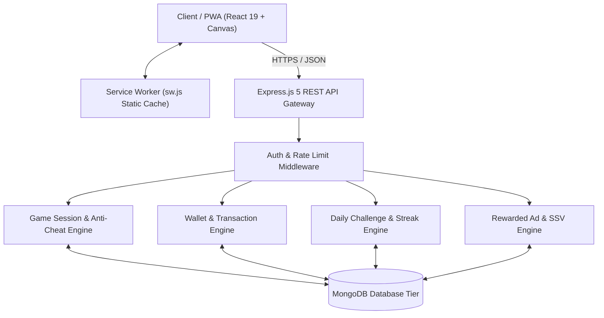
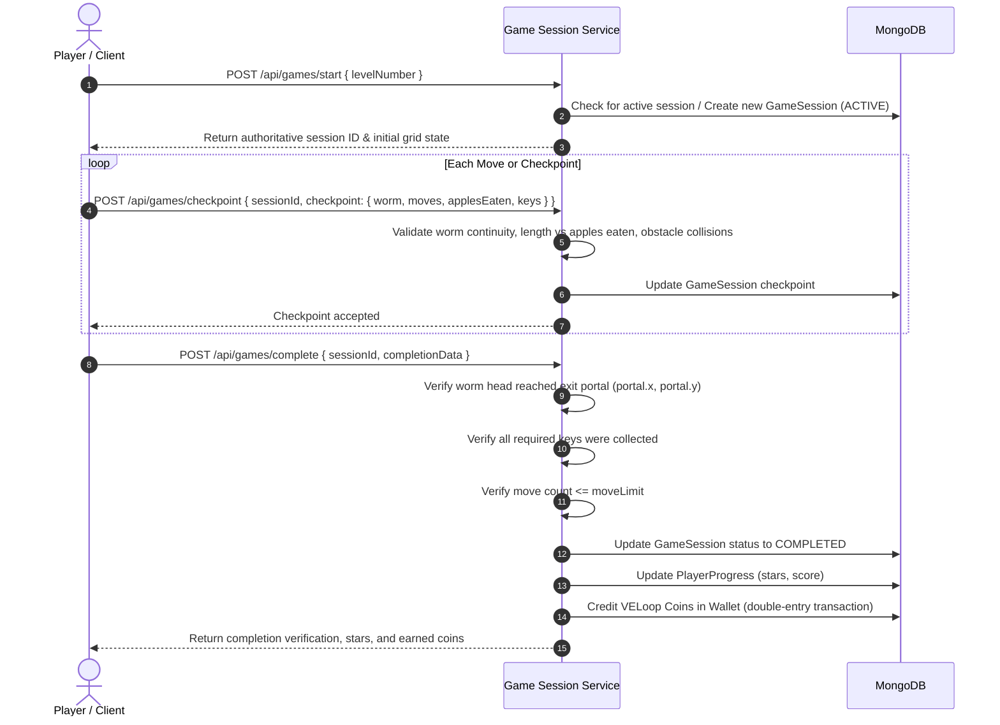
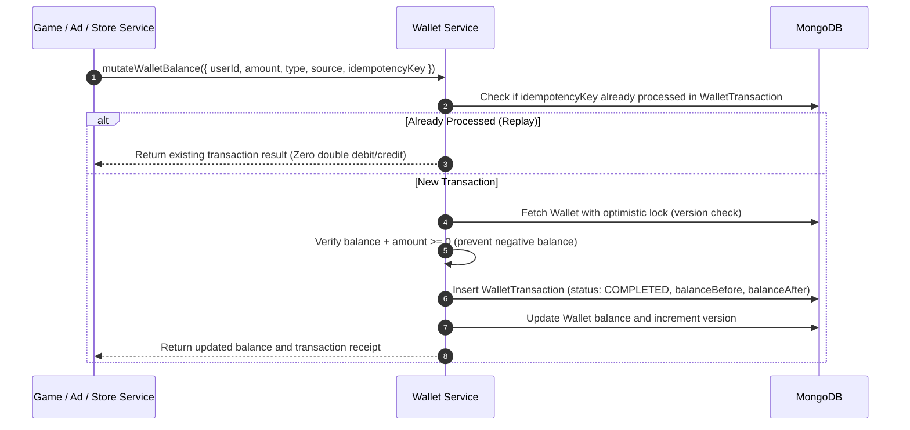

# Apple Worm Adventure — System Architecture Documentation

> Technical architecture reference for Apple Worm Adventure (VELoop Rewards Edition), detailing frontend rendering, server-authoritative physics, transactional wallet economy, anti-cheat validation, daily streaks, global leaderboards, and Progressive Web App infrastructure.

---

## 1. High-Level Architecture Overview

The system follows a three-tier architecture:
1. **Frontend Presentation & PWA Tier**: Built with React 19 and Vite 8, featuring an HTML5 Canvas rendering engine with Retina scaling, responsive touch and swipe input handlers, audio feedback, and offline Service Worker caching.
2. **Backend API & Game Engine Tier**: Built on Node.js and Express 5, providing tiered rate limiting, JWT authentication, server-authoritative game session verification, transaction rollback mechanisms, and scheduled recovery workers.
3. **Database Tier**: MongoDB with Mongoose ODM, leveraging compound unique indexes, optimistic concurrency locking, and atomic transactional operations.

---

## 2. Frontend Architecture

### 2.1 Component & Page Hierarchy
- **`App.jsx`**: Root screen coordinator and session lifecycle manager. Manages `currentScreen` state (`HOME`, `LEVELS`, `GAME_READY`, `GAME`, `WALLET`, `REWARDS`, `LEADERBOARD`, `ACHIEVEMENTS`, `DAILY`, `ADMIN`). Renders the live network status banner when offline.
- **Context Providers**:
  - `AuthContext`: Manages JWT token storage in `localStorage`, user authentication state, profile fetching, login, registration, and logout.
  - `WalletContext`: Maintains authoritative player coin balance with optimistic local updates and server synchronization.
- **`GameCanvas.jsx`**:
  - High-performance HTML5 Canvas renderer executing inside `requestAnimationFrame`.
  - Retina resolution multiplier (`window.devicePixelRatio`).
  - Organic apple rendering (2-lobe silhouette, curved stem, leaf spine, specular reflections).
  - Procedural particle burst engine for collectibles and victory celebrations.
  - Floating feedback notifications (+100 score, +50 stars, +2 growth, +5 moves).
  - Touch and swipe gesture listeners with cardinal direction classification (`UP`, `DOWN`, `LEFT`, `RIGHT`) and `touch-action: none`.
- **`GameControls.jsx`**:
  - Tactile virtual D-pad buttons ($\ge 44\times 44$px).
  - Action buttons (`Undo`, `Hint`, `+5 Moves Booster`, `Restart`) with dynamic cost/stock badges.
  - Live HUD status bar displaying remaining moves, coins, collected keys, and audio mute toggle.
- **`RewardedAdModal.jsx`**:
  - Interactive simulated video ad player with countdown timer, anti-skip enforcement, and Server-Side Verification (SSV) callback simulation.
- **`GameDialogs.jsx`**:
  - `VictoryDialog`: Renders cleared level stats, earned stars, coin rewards, and bonus ad multipliers (Double Score, Double Coins).
  - `FailureDialog`: Renders failure reason (out of moves, hit spike, fell into pit) with an immediate option for a **Second Chance Revive** rewarded ad.

### 2.2 PWA & Offline Strategy
- **`client/public/sw.js`**:
  - Pre-caches core application shell (`index.html`, `manifest.webmanifest`, `favicon.svg`, icons).
  - Stale-While-Revalidate caching for static `.js`, `.css`, and image assets.
  - **Strict Network-Only for `/api/*`**: API requests bypass cache entirely. If network is offline, returns HTTP 503 JSON to prevent client-side state corruption.

---

## 3. Backend Architecture

### 3.1 Middleware Pipeline
1. **`helmet`**: Sets HTTP security headers (X-Content-Type-Options, Frameguard, etc.).
2. **`cors`**: Whitelists configured `CLIENT_URL` with credentials support.
3. **`express.json({ limit: '10kb' })`**: Protects against JSON payload flooding.
4. **Tiered Rate Limiting**:
   - `authLimiter`: Max 50 requests per 15 minutes on `/api/auth/*` (brute-force defense).
   - `apiLimiter`: Max 3000 requests per 15 minutes on `/api/*` (supports high-frequency puzzle moves and checkpoints).
5. **`protect` (Auth Middleware)**: Extracts and verifies JWT Bearer token, populates `req.user`.
6. **`requireAdmin`**: Enforces role === `'admin'` on level editor routes.

### 3.2 Service Layer Design
- **`gameSessionService.js`**: Initializes sessions, validates moves, tracks worm growth, verifies portal reachability, and finalizes rewards.
- **`walletService.js`**: Manages double-entry coin transactions, baseline initialization, balance queries, item purchases, and balance rollbacks.
- **`walletRecoveryService.js`**: Background scheduler that automatically cleans up pending transactions from unconfirmed crashes or network drops.
- **`dailyChallengeService.js`**: Deterministic level selection by calendar date (UTC), streak validation, and milestone rewards.
- **`leaderboardService.js`**: Aggregates player scores, completed levels, and stars to produce paginated global rankings.
- **`achievementService.js`**: Evaluates player progression against 10 achievement criteria and disburses atomic coin rewards.
- **`rewardedAdService.js`**: Manages ad quota reservations, placement cooldowns, anti-fraud SSV signature verification, and reward fulfillment.

---

## 4. MongoDB Data Models & Schemas

### 4.1 Collection Summary
| Collection | Model File | Purpose | Primary / Unique Indexes |
| :--- | :--- | :--- | :--- |
| `users` | `User.js` | Player accounts, credentials, roles | `{ email: 1 }`, `{ username: 1 }` |
| `wallets` | `Wallet.js` | Authoritative VELoop Coin balances | `{ userId: 1 }` (unique) |
| `wallettransactions` | `WalletTransaction.js` | Immutable double-entry ledger | `{ idempotencyKey: 1 }` (unique), `{ operationId: 1 }` (sparse unique), `{ userId: 1, createdAt: -1 }` |
| `levels` | `Level.js` | Puzzle grid layouts, obstacles, portal | `{ levelNumber: 1 }` (unique) |
| `gamesessions` | `GameSession.js` | Active & historical gameplay sessions | `{ userId: 1, levelNumber: 1 }`, `{ status: 1 }` |
| `inventories` | `Inventory.js` | Consumable item quantities | `{ userId: 1 }` (unique) |
| `playerprogresses` | `PlayerProgress.js` | Level completion stars and high scores | `{ userId: 1, levelNumber: 1 }` (unique) |
| `playerachievements` | `PlayerAchievement.js` | Achievement unlock & claim status | `{ userId: 1, achievementId: 1 }` (unique) |
| `dailychallengecompletions` | `DailyChallengeCompletion.js`| Daily puzzle completion records | `{ userId: 1, date: 1 }` (unique) |
| `playerdailystreaks` | `PlayerDailyStreak.js` | Current streak, record streak, milestones | `{ userId: 1 }` (unique) |
| `adopportunities` | `AdOpportunity.js` | Ad watch sessions and SSV tokens | `{ opportunityId: 1 }` (unique), `{ userId: 1 }` |
| `adquotareservations` | `AdQuotaReservation.js`| Daily placement quotas and cooldowns | `{ userId: 1, placement: 1, dateKey: 1 }` |
| `economyconfigs` | `EconomyConfig.js` | Dynamic store prices, multipliers, limits | None (single document) |

---

## 5. Core Game & Economy Flows

### 5.1 Game Session Lifecycle & Anti-Cheat Flow

### 5.2 Wallet Transaction Architecture & Double-Entry Ledger

### 5.3 Daily Challenge & Streak Architecture
- **Deterministic Puzzle Generation**: The date string in `YYYY-MM-DD` (UTC) is hashed to deterministically select an active level from the level pool. Every player worldwide gets the exact same level on any given date.
- **Streak Calculation**:
  - If a player completed yesterday's challenge: `currentStreak = currentStreak + 1`.
  - If more than 1 day lapsed: `currentStreak = 1` (streak reset).
  - `longestStreak = max(longestStreak, currentStreak)`.
- **Milestone Rewards**:
  - Tiered rewards for reaching **3 Days** (+100 coins), **7 Days** (+250 coins), **14 Days** (+600 coins), and **30 Days** (+1500 coins).
  - Claimed milestone IDs are saved in `PlayerDailyStreak.claimedMilestones` preventing repeated claims.

---

## 6. Security, Anti-Cheat & Resiliency

1. **Server-Authoritative Anti-Cheat**:
   - The client never dictates star ratings, high scores, or coin grants.
   - The server verifies that the final worm position touches the portal coordinates.
   - The server verifies that worm length matches initial length plus all eaten apples.
   - If a gate was traversed, the server verifies that the corresponding key was gathered in the session.
2. **Idempotency & Replay Protection**:
   - All balance mutations, ad views, and milestone claims require an `idempotencyKey`.
   - MongoDB compound unique index `{ idempotencyKey: 1 }` rejects duplicate concurrent requests at the database driver level.
3. **Graceful Shutdown & Background Recovery**:
   - `server.js` listens for `SIGTERM` and `SIGINT`.
   - First pauses new incoming connections, invokes `drainAndStopRecovery()` to allow in-flight transaction recovery tasks to conclude within a bounded timeout ($10$s), and safely disconnects from MongoDB.
