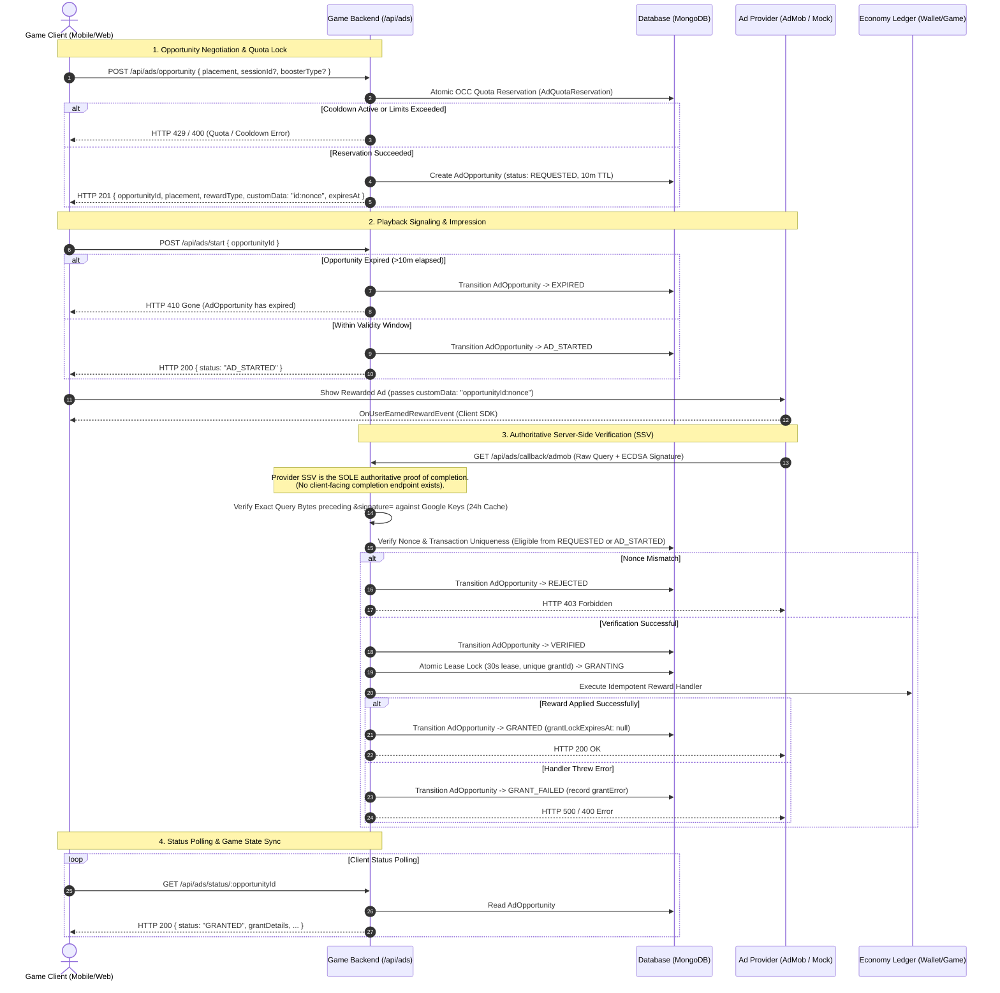
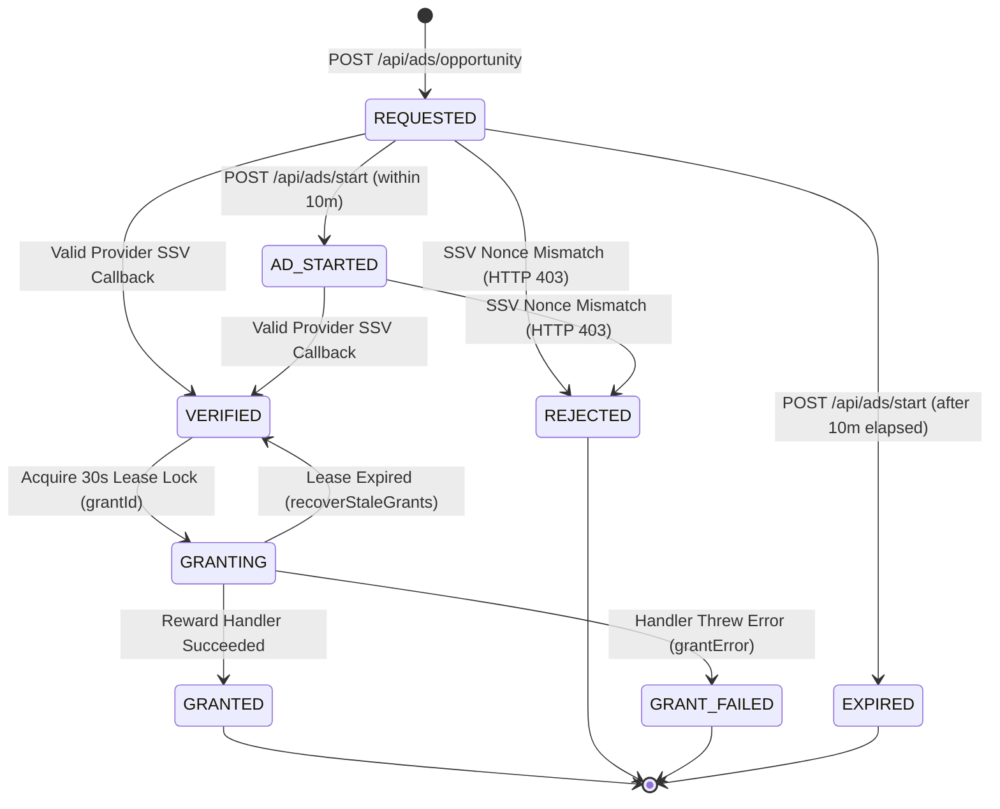

# VELoop Economy Phase 2: Rewarded Ads & Economy Integration Specification

> **Document Version:** 2.2.0  
> **Authoritative Source:** Reconciled against backend implementation files (`AdOpportunity.js`, `AdQuotaReservation.js`, `EconomyConfig.js`, `adProviderService.js`, `rewardedAdService.js`, `gameSessionService.js`, `walletService.js`, `WalletTransaction.js`, and `adRoutes.js`).  
> **Project:** Apple Worm Adventure (VELoop Rewards)  
> **Runtime Environment:** Node.js (ES Modules) / Express / MongoDB (Mongoose)

---

## 1. Executive Summary & Architecture Overview

The VELoop Economy Phase 2 architecture integrates a secure, fraud-resistant, and recoverable rewarded ad framework into Apple Worm Adventure. By strictly decoupling ad opportunity reservation, client-side video playback, server-side callback verification (SSV), and economy ledger grants, the system prevents client-side spoofing, replay attacks, duplicate rewards, and concurrent quota exploitation.

### 1.1 End-to-End System Flow



### 1.2 Separation of Concerns

1. **Opportunity Brokerage (`POST /api/ads/opportunity`)**: Pre-allocates an ad slot, validates placement prerequisites, checks session ownership, generates a 32-character cryptographic nonce, and acquires an atomic database quota reservation using Optimistic Concurrency Control (OCC).
2. **Playback Signaling (`POST /api/ads/start`)**: Validates ownership, checks the 10-minute validity window (transitioning to `EXPIRED` if exceeded), and marks eligible opportunities as `AD_STARTED`.
3. **Authoritative Provider Verification (`/api/ads/callback/*`)**: Provider webhooks deliver the sole authoritative proof of completion. There is **no client-facing completion endpoint**; clients cannot signal completion directly. Callbacks verify signatures, match custom data nonces, and guarantee provider transaction uniqueness. Callbacks accept opportunities in both `REQUESTED` and `AD_STARTED` states.
4. **Resilient Grant Execution (`GRANTING` Lease)**: Applies in-game benefits or credits the append-only ledger under a 30-second mutual-exclusion lease lock. Every reward handler is completely idempotent.
5. **State Synchronization (`GET /api/ads/status/:opportunityId`)**: Allows the client to poll for reward finalization without exposing grant execution logic to client-side manipulation.

---

## 2. Core Principles & Security Invariants

### 2.1 Cryptographic Server-Side Verification (SSV)
* **Google AdMob ECDSA Verification**: AdMob delivers an ECDSA signature over the raw query string UTF-8 bytes. The backend isolates the raw query string directly from the transport layer, extracts the exact bytes preceding `&signature=`, and verifies the signature using the Google public key associated with `key_id`.
* **Google Public Key Endpoint & Caching**: Public verification keys are retrieved from `https://admob.googleapis.com/v1/publicKeys`. Retrieved keys are cached in-memory with a strict 24-hour Time-To-Live (`KEY_CACHE_TTL_MS = 24 * 60 * 60 * 1000`). If an unrecognized `key_id` is supplied, a single immediate cache refresh is triggered.
* **Mock Provider Isolation**: A mock provider exists strictly for development and testing (`POST /api/ads/callback/mock`). It requires the `X-Mock-Provider-Secret` header matching `process.env.MOCK_PROVIDER_SECRET` (falling back in dev/test to `'test_mock_ssv_secret_dev'`). In production (`NODE_ENV === 'production'`), mock callbacks fail closed with HTTP 403 / 404.

### 2.2 Replay Protection & Transaction Uniqueness
* **Sparse Unique Provider Transaction Index**: Every callback supplies a provider transaction ID. The `AdOpportunity` MongoDB collection enforces a **sparse, unique index** on `providerTransactionId`. Any callback attempting to reuse an existing transaction ID on another opportunity is rejected with HTTP 409 Conflict. Redelivery of the identical transaction ID for the same opportunity returns the existing status idempotently.
* **Cryptographic Custom Data Nonce**: When an opportunity is negotiated, the server creates a 32-character hexadecimal nonce (`crypto.randomBytes(16).toString('hex')`). This nonce is bound to the opportunity and packed into the provider custom data.
* **Strict Custom Data Format**: The custom data string transmitted to providers and returned in SSV callbacks is strictly formatted as:
  $$\text{customData} = \text{opportunityId} : \text{nonce}$$
  Callbacks unpack this parameter and verify that `opportunity.customDataNonce === nonce`. If mismatched, the opportunity transitions to `REJECTED` with HTTP 403.

### 2.3 Resilient Granting Lease Lock & Recovery
* Before executing a reward handler, the server acquires a 30-second lease lock (`GRANT_LEASE_TIMEOUT_MS = 30000`) by atomically setting `status = 'GRANTING'`, assigning a unique `grantId = crypto.randomUUID()`, and defining `grantLockExpiresAt = new Date(Date.now() + 30000)`.
* If a server crashes during reward processing, the lease expires. Background recovery workers (`recoverStaleGrants()`) safely reprocess stale grants without interference.

### 2.4 Application-Level Ledger Immutability
* All coin rewards credit the player's wallet via the Phase 1 `WalletTransaction` collection through `walletService.credit()`.
* **Mongoose Middleware Protection**: The Mongoose schema registers `pre` query hooks on `updateOne`, `updateMany`, `findOneAndUpdate` (which also catches `findByIdAndUpdate`), `deleteOne`, and `deleteMany` to throw an error if mutation or deletion is attempted via standard Mongoose queries. The `createdAt` field is marked `immutable: true`.
* **Architectural Scope**: These protections operate at the **Mongoose application layer**. They do not represent storage-engine-level immutability (such as database capped collections or read-only database user roles); direct operations via native MongoDB drivers, administrative scripts, or the Mongo shell bypass Mongoose middleware.

### 2.5 Strict Separation of Coins and Competitive Score
* In-game currency (`coins`) and competitive leaderboard scoring (`score`, `totalScore`, `highScore`) remain strictly isolated. Coin grants affect wallet balance; score doubling affects game session records and level star metrics.

---

## 3. Rewarded Ad Lifecycle & Authoritative State Machine



### 3.1 Implemented State Enum vs. Runtime Usage (`AD_OPPORTUNITY_STATUSES`)

The `AdOpportunity` model schema defines a 10-value status enum:

```javascript
export const AD_OPPORTUNITY_STATUSES = [
  'REQUESTED',
  'AD_STARTED',
  'AD_COMPLETED',
  'VERIFYING',
  'VERIFIED',
  'GRANTING',
  'GRANTED',
  'REJECTED',
  'EXPIRED',
  'GRANT_FAILED',
];
```

The runtime implementation actively utilizes 8 of these 10 states:

| State | Runtime Status | Implementation Behavior |
| :--- | :--- | :--- |
| **`REQUESTED`** | **Active** | Initial state upon creation via `POST /api/ads/opportunity`. Quota slot reserved. Can transition to `AD_STARTED` via `POST /api/ads/start` (if $\le 10\text{m}$), to `EXPIRED` via `POST /api/ads/start` (if $> 10\text{m}$), or directly to `VERIFIED` / `REJECTED` upon provider callback delivery. |
| **`AD_STARTED`** | **Active** | Transitioned by `POST /api/ads/start` when called within the 10-minute validity window. Transitions to `VERIFIED` upon valid callback or `REJECTED` upon nonce mismatch. |
| **`AD_COMPLETED`** | *Dormant Enum* | Defined in schema enum for design completeness; **never assigned in runtime code**. No client completion endpoint exists. |
| **`VERIFYING`** | *Transient Enum* | Defined in schema enum; in runtime code, callbacks directly assign `VERIFIED` without persisting `VERIFYING`. |
| **`VERIFIED`** | **Active** | Transitioned from either `REQUESTED` or `AD_STARTED` upon successful SSV signature verification, transaction uniqueness, and custom-data nonce match. Ready for reward granting. |
| **`GRANTING`** | **Active** | Active 30-second mutual-exclusion lease lock (`grantLockExpiresAt`, `grantId`). Reward handler executing. |
| **`GRANTED`** | **Active (Terminal)** | Reward successfully applied to wallet, session, or progress. |
| **`REJECTED`** | **Active (Terminal)** | Transitioned from either `REQUESTED` or `AD_STARTED` when callback arrival fails the cryptographic custom-data nonce match. |
| **`GRANT_FAILED`** | **Active (Terminal)** | Reward handler threw an exception during `GRANTING` (error details recorded in `grantError`). |
| **`EXPIRED`** | **Active (Terminal)** | Transitioned during `POST /api/ads/start` if more than 10 minutes have elapsed since creation. |

### 3.2 Opportunity Expiration, Callback Eligibility & Security Limitations

* **Enforced Exclusively at Playback Start (`POST /api/ads/start`)**:  
  Application-level expiration is governed by `OPPORTUNITY_TTL_MS = 10 * 60 * 1000` (10 minutes). When `startAd()` is called:
  ```javascript
  if (new Date() > opportunity.expiresAt) {
    opportunity.status = 'EXPIRED';
    await opportunity.save();
    const error = new Error('AdOpportunity has expired.');
    error.statusCode = 410;
    throw error;
  }
  ```
* **Callback Acceptance Across States & No Expiration Verification**:  
  The provider callback handler (`rewardedAdService.processProviderCallback`) queries opportunities by `_id` and does **not** evaluate `opportunity.expiresAt`, nor does it require an opportunity to be in `AD_STARTED`. Callbacks are accepted and processed for opportunities in either `REQUESTED` or `AD_STARTED` state, regardless of elapsed time.
* **Security Limitation — Callback Eligibility of Expired Opportunities**:  
  > [!WARNING]
  > **Security Limitation — Callback Processing Without Expiration Checks:**  
  > Because callbacks do not check `expiresAt`, an opportunity whose 10-minute validity window has elapsed—but which remains in a callback-eligible state (such as `REQUESTED` if `startAd` was never called, or `AD_STARTED` if playback began before expiration)—can still receive a reward if a provider callback arrives with a valid cryptographic signature, unique transaction ID, and matching custom-data nonce. Expiration enforcement is strictly confined to the playback-start gate (`POST /api/ads/start`).
* **Database TTL Index**:  
  In `AdOpportunity.js`, `expiresAt` is indexed for querying (`{ type: Date, required: true, index: true }`), but **no automatic MongoDB TTL index is attached**. Documents persist until cleaned up by external retention scripts.

---

## 4. Server-Side Verification (SSV) Protocols

### 4.1 Google AdMob SSV Protocol (`GET /api/ads/callback/admob`)

Google AdMob delivers an HTTP `GET` webhook containing the ad network verification parameters.

#### 4.1.1 Strict Raw Query String Verification
AdMob ECDSA signatures are calculated across the exact query string UTF-8 bytes. Reconstructing query strings from parsed JavaScript objects or sorting parameters alters byte order and breaks cryptographic verification.

In `adProviderService.js`:
```javascript
// Extract exact message bytes preceding &signature=
const sigIndex = rawQueryString.indexOf('&signature=');
const messageToVerify = sigIndex !== -1 ? rawQueryString.substring(0, sigIndex) : rawQueryString;
```
* The implementation isolates the substring of `rawQueryString` from index 0 up to `&signature=`.
* It does **not** strip `&key_id=` or reorder parameters.
* The signature is normalized from web-safe base64:
  ```javascript
  const normalizedSig = signature.replace(/-/g, '+').replace(/_/g, '/');
  const sigBuffer = Buffer.from(normalizedSig, 'base64');
  ```
* Verified using Node's native `crypto.createVerify('SHA256')` against the PEM-converted Google public key.

#### 4.1.2 Public Key Caching Architecture
* **Endpoint**: `https://admob.googleapis.com/v1/publicKeys`
* **Response Format**: `{ keys: [ { keyId: "1234", base64: "..." } ] }`
* **Cache TTL**: In-memory caching with `KEY_CACHE_TTL_MS = 24 * 60 * 60 * 1000` (24 hours).
* **Format Conversion**: SubjectPublicKeyInfo base64 strings are wrapped into standard PEM format (`-----BEGIN PUBLIC KEY-----...`).

---

### 4.2 Mock SSV Protocol (`POST /api/ads/callback/mock`)

Enables deterministic automated integration testing in non-production environments.

* **Security Controls**:
  - Disabled in production: If `process.env.NODE_ENV === 'production'`, returns HTTP 404 / 403.
  - Requires `X-Mock-Provider-Secret` header matching `process.env.MOCK_PROVIDER_SECRET || 'test_mock_ssv_secret_dev'`.
* **Payload Structure**:
  ```json
  {
    "custom_data": "65f2a1b4c9e8d7001a2b3c4d:8f0a2c4e6b8d0e2f1a3b5c7d9e1f3a5b",
    "transaction_id": "mock_tx_1710000000000_abc123"
  }
  ```

---

## 5. Placement Matrix & Supported Reward Types

The system defines 6 authoritative placements and 6 core reward types:

```javascript
// From src/models/AdOpportunity.js
export const AD_PLACEMENTS = [
  'GAME_OVER_REVIVE',
  'MOVE_EXHAUSTED_EXTRA',
  'SESSION_BOOSTER',
  'POST_WIN_DOUBLE_COIN',
  'POST_WIN_DOUBLE_SCORE',
  'STORE_FREE_COINS'
];

export const AD_REWARD_TYPES = [
  'REVIVE',
  'EXTRA_MOVES',
  'BOOSTER',
  'DOUBLE_COINS',
  'DOUBLE_SCORE',
  'COIN_REWARD'
];
```

### 5.1 Authoritative Placement Mapping

| Placement Identifier | Authoritative Reward Type | Scope | Default Amount | Prerequisites / Validation |
| :--- | :--- | :--- | :--- | :--- |
| `STORE_FREE_COINS` | `COIN_REWARD` | Wallet | 25 Coins | Cooldown and hourly/daily limits. |
| `GAME_OVER_REVIVE` | `REVIVE` | Session | 1 Revive | Session must be in `FAILED` status; max 1 revive per session. |
| `MOVE_EXHAUSTED_EXTRA` | `EXTRA_MOVES` | Session | +5 Moves | Session must be in `ACTIVE` status. |
| `SESSION_BOOSTER` | `BOOSTER` | Session | 1 Booster | Session must be active; booster added to `availableBoosters`. |
| `POST_WIN_DOUBLE_COIN` | `DOUBLE_COINS` | Session | Session Coins | Session must be `COMPLETED`; doubles base level coins. |
| `POST_WIN_DOUBLE_SCORE` | `DOUBLE_SCORE` | Session | Session Score | Session must be `COMPLETED`; doubles session score. |

> [!NOTE]
> **Status of `HINT` Reward**:  
> In-game hints are not included in `AD_PLACEMENTS` and have no implemented ad reward handler. Hints remain classified as **Planned / Future Extension**.

---

## 6. API Specification & Endpoints

Routes are mounted at `/api/ads` via `server/src/routes/adRoutes.js` and handled by `server/src/controllers/rewardedAdController.js`.

### 6.1 Create Ad Opportunity

```http
POST /api/ads/opportunity
Authorization: Bearer <jwt_token>
Content-Type: application/json
```

#### Request Payload
```json
{
  "placement": "STORE_FREE_COINS",
  "sessionId": "65f2a1b4c9e8d7001a2b3c4d",
  "boosterType": "APPLE_MAGNET"
}
```
* `sessionId`: Required for session placements (`GAME_OVER_REVIVE`, `MOVE_EXHAUSTED_EXTRA`, `SESSION_BOOSTER`, `POST_WIN_DOUBLE_COIN`, `POST_WIN_DOUBLE_SCORE`). Optional for `STORE_FREE_COINS`.
* `boosterType`: Optional, defaults to `'APPLE_MAGNET'`.

#### Response (201 Created)
```json
{
  "success": true,
  "message": "Ad opportunity created and quota reserved successfully.",
  "data": {
    "opportunityId": "65f2a1b4c9e8d7001a2b3c4d",
    "placement": "STORE_FREE_COINS",
    "rewardType": "COIN_REWARD",
    "rewardAmount": 25,
    "customDataNonce": "8f0a2c4e6b8d0e2f1a3b5c7d9e1f3a5b",
    "customData": "65f2a1b4c9e8d7001a2b3c4d:8f0a2c4e6b8d0e2f1a3b5c7d9e1f3a5b",
    "expiresAt": "2026-03-30T12:10:00.000Z"
  }
}
```

#### Error Codes
* `400 Bad Request`: Invalid placement, invalid `sessionId` format, or session status prerequisite violation.
* `403 Forbidden`: Session does not belong to the requesting user.
* `404 Not Found`: Game session not found.
* `429 Too Many Requests`: Cooldown active (30s), hourly limit exceeded (6/hr), daily limit exceeded (20/day), session limit exceeded (3/session), or concurrent OCC conflict.

---

### 6.2 Signal Ad Playback Start

```http
POST /api/ads/start
Authorization: Bearer <jwt_token>
Content-Type: application/json
```

#### Request Payload
```json
{
  "opportunityId": "65f2a1b4c9e8d7001a2b3c4d"
}
```

#### Response (200 OK)
```json
{
  "success": true,
  "message": "Ad playback started.",
  "data": {
    "opportunityId": "65f2a1b4c9e8d7001a2b3c4d",
    "status": "AD_STARTED"
  }
}
```

#### Error Codes
* `400 Bad Request`: `opportunityId` missing in request body.
* `403 Forbidden`: Opportunity does not belong to the user.
* `404 Not Found`: Opportunity not found.
* `410 Gone`: Opportunity has expired (>10 minutes elapsed since creation; status transitioned to `EXPIRED`).

---

### 6.3 Poll Opportunity Status

```http
GET /api/ads/status/:opportunityId
Authorization: Bearer <jwt_token>
```

#### Response (200 OK)
```json
{
  "success": true,
  "data": {
    "opportunityId": "65f2a1b4c9e8d7001a2b3c4d",
    "status": "GRANTED",
    "rewardType": "COIN_REWARD",
    "rewardAmount": 25,
    "grantDetails": {
      "coinsAwarded": 25,
      "balanceAfter": 125,
      "transactionId": "65f2a1b4c9e8d7001a2b3c4e"
    },
    "grantedAt": "2026-03-30T12:00:35.000Z",
    "expiresAt": "2026-03-30T12:10:00.000Z"
  }
}
```

---

### 6.4 Provider Webhooks

#### AdMob Callback (`GET /api/ads/callback/admob`)
* Extracts raw query string directly from `req.originalUrl`.
* Accepts and processes opportunities in both `REQUESTED` and `AD_STARTED` states.
* Returns `200 OK` on successful validation and reward grant.
* Returns `400 Bad Request` if signature or parameters are invalid.
* Returns `403 Forbidden` if `customDataNonce` mismatches (status transitions to `REJECTED`).
* Returns `409 Conflict` if `transaction_id` was already utilized by another opportunity.

#### Mock Callback (`POST /api/ads/callback/mock`)
* Validates `X-Mock-Provider-Secret` header and `custom_data` payload.
* Accepts opportunities in both `REQUESTED` and `AD_STARTED` states.
* Transitions through `VERIFIED` $\rightarrow$ `GRANTING` $\rightarrow$ `GRANTED`.

---

## 7. Centralized Economy Configuration & Quota Management

All limits and rewards are centralized in `EconomyConfig.js` (`key: 'active_economy_config'`).

### 7.1 Verified Configuration Defaults

```javascript
adLimits: {
  maxAdsPerSession: 3,         // Maximum ads permitted per game session
  maxAdsPerHour: 6,            // Hourly opportunity limit (rolling 60-minute window)
  maxAdsPerDay: 20,            // Daily Rewarded-Ad Opportunity Limit (rolling 24-hour window)
  minSecondsBetweenAds: 30,    // Mandatory cooldown between ad requests (30 seconds)
  maxRevivesPerSession: 1,     // Maximum revives allowed per game session
  maxCoinRewardCap: 100,       // Reference ceiling for ad rewards (CONFIGURED)
  baseCoinReward: 25,          // Base coins granted for STORE_FREE_COINS
  extraMovesReward: 5          // Extra moves granted for MOVE_EXHAUSTED_EXTRA
}
```

> [!NOTE]
> **Enforcement Status of `maxCoinRewardCap`**:  
> In `EconomyConfig.js`, `maxCoinRewardCap` defaults to 100. In `rewardedAdService.js`, coin reward amounts are assigned directly via `rules.baseCoinReward || 25` (or calculated from level completion earnings). Thus, `maxCoinRewardCap` is **CONFIGURED** in the schema as a reference ceiling, but is **NOT ACTIVELY CLAMPED** inside the reward handler calculation.

> [!IMPORTANT]
> **Daily Rewarded-Ad Opportunity Limit**:  
> The `maxAdsPerDay: 20` quota limits rewarded ad opportunities, not total coins accumulated from gameplay, star thresholds, or golden apples.

---

### 7.2 Atomic OCC / Version-Locked Quota Reservations

Rather than relying on non-atomic count-then-create queries, the system uses single-document Optimistic Concurrency Control (OCC) in `AdQuotaReservation.js`.

#### 7.2.1 Data Structure
```javascript
const adQuotaReservationSchema = new mongoose.Schema({
  userId: { type: mongoose.Schema.Types.ObjectId, ref: 'User', required: true, unique: true, index: true },
  lastRequestedAt: { type: Date, default: null, index: true },
  reservations: [{
    opportunityId: { type: mongoose.Schema.Types.ObjectId, required: true },
    sessionId: { type: mongoose.Schema.Types.ObjectId, default: null },
    rewardType: { type: String, required: true },
    createdAt: { type: Date, default: Date.now }
  }],
  version: { type: Number, default: 0 }
}, { timestamps: true, versionKey: false });
```

#### 7.2.2 OCC Reservation Execution Algorithm (`AdQuotaReservation.reserveQuota`)
1. **Fetch / Upsert Quota Document**: Find user document by `userId` or create initial record (`version: 0`).
2. **Cooldown Check**:  
   If `quotaDoc.lastRequestedAt` exists and `(now - lastRequestedAt) < 30s`, throw HTTP 429 (`Ad cooldown active`).
3. **Sliding Window Pruning**:  
   Filter `reservations` in memory against rolling windows:  
   - `dayAgo = new Date(now - 86400000)` (24 hours)  
   - `hourAgo = new Date(now - 3600000)` (60 minutes)
4. **Quota Evaluations**:
   - Hourly: Count in past hour $\ge 6 \implies$ throw HTTP 429.
   - Daily: Count in past 24 hours $\ge 20 \implies$ throw HTTP 429.
   - Session: If `sessionId` provided, count for session $\ge 3 \implies$ throw HTTP 429.
   - Revive: If `rewardType === 'REVIVE'`, count for session $\ge 1 \implies$ throw HTTP 400.
5. **Atomic Commit with Version Lock**:  
   Execute an atomic conditional update:
   ```javascript
   const filter = { userId, version: quotaDoc.version };
   if (quotaDoc.lastRequestedAt) {
     filter.lastRequestedAt = { $lte: new Date(now - cooldownMs) };
   }

   const updated = await this.findOneAndUpdate(
     filter,
     {
       $set: {
         lastRequestedAt: new Date(now),
         reservations: validReservations.concat([newReservation]),
       },
       $inc: { version: 1 },
     },
     { returnDocument: 'after' }
   );
   ```
6. **Concurrency Conflict Retry**: If `updated` is null (concurrent modification), retry up to 3 attempts before returning HTTP 429 (`Concurrent ad reservation conflict`).

---

## 8. Reward Handlers, Idempotency & Game Integration

Rewards are applied in `rewardedAdService.js` under the 30-second `GRANTING` lease lock.

### 8.1 Free Coins (`COIN_REWARD`)
* **Placement**: `STORE_FREE_COINS`
* **Handler**: Invokes `walletService.credit()`:
  ```javascript
  const creditResult = await walletService.credit(userId, amount, {
    type: 'AD_REWARD',
    referenceId: opportunity._id.toString(),
    idempotencyKey: `ad_reward_${opportunity._id}`,
    description: `Watched rewarded ad for ${amount} coins`,
    metadata: {
      opportunityId: opportunity._id.toString(),
      placement: opportunity.placement,
      providerTransactionId: opportunity.providerTransactionId,
    },
  });
  ```
* **Idempotency Key**: `ad_reward_${opportunity._id}`

### 8.2 Game Revive (`REVIVE`)
* **Placement**: `GAME_OVER_REVIVE`
* **Validation**: Session must be in `FAILED` status.
* **Execution**: Atomically transitions `session.status = 'ACTIVE'`, resets `endedAt` and `failureReason`, increments `revivesUsed += 1`, and appends to `session.appliedAdRewards`.
* **Idempotency**: Verifies `appliedAdRewards` for `opportunity._id`. If already applied, returns cleanly.

### 8.3 Extra Moves (`EXTRA_MOVES`)
* **Placement**: `MOVE_EXHAUSTED_EXTRA`
* **Validation**: Session must be in `ACTIVE` status.
* **Execution**: Atomically increments `session.extraMovesAllowed += 5` and appends to `session.appliedAdRewards`.
* **Gameplay Integration**: In `gameSessionService.js`, allowed moves during checkpoint and level completion validation are calculated as:
  $$\text{allowedMoves} = \text{level.moveLimit} + (\text{session.extraMovesAllowed} \parallel 0)$$

### 8.4 Boosters (`BOOSTER`)
* **Placement**: `SESSION_BOOSTER`
* **State Separation**: Newly granted boosters are pushed into `session.availableBoosters` (e.g. `['APPLE_MAGNET']`). Consumed boosters are stored in `session.boostersUsed`. Boosters are never written directly to `boostersUsed`.
* **Idempotency**: Checked against `session.appliedAdRewards`.

### 8.5 Level End Double Coins (`DOUBLE_COINS`)
* **Placement**: `POST_WIN_DOUBLE_COIN`
* **Validation**: Session must be `COMPLETED`.
* **Execution**: Invokes `walletService.credit()` for bonus coins equal to `session.coinsEarned`. Updates `session.coinsEarned += bonusCoins` and records in `appliedAdRewards`.
* **Idempotency Key**: `ad_reward_double_coins_${opportunity._id}`

### 8.6 Level End Double Score (`DOUBLE_SCORE`)
* **Placement**: `POST_WIN_DOUBLE_SCORE`
* **Validation**: Session must be `COMPLETED`.
* **Execution**:
  1. Atomically doubles score on `GameSession` using a conditional update:
     ```javascript
     const updatedSession = await GameSession.findOneAndUpdate(
       {
         _id: sessionId,
         'appliedAdRewards.rewardType': { $ne: 'DOUBLE_SCORE' },
         'appliedAdRewards.opportunityId': { $ne: opportunity._id.toString() },
       },
       {
         $set: { score: newScore },
         $push: {
           appliedAdRewards: {
             opportunityId: opportunity._id.toString(),
             rewardType: 'DOUBLE_SCORE',
             amount: bonusScore,
             appliedAt: new Date(),
           },
         },
       },
       { returnDocument: 'after' }
     );
     ```
  2. Updates `PlayerProgress` sequentially: increments `totalScore` by `bonusScore` and updates `highScore` if exceeded.
* **Partial-Failure Limitation**:
  > [!WARNING]
  > **Distributed Update Boundary**:  
  > While the `GameSession` score doubling is atomically guarded against duplicate execution, the subsequent update to `PlayerProgress` is executed sequentially via standard Mongoose `save()` without a multi-document MongoDB transaction. If the server process crashes between the session update and progress save, the session score remains doubled while player total score requires administrative recalculation.

---

## 9. Data Models & Database Schemas

### 9.1 `AdOpportunity` (`server/src/models/AdOpportunity.js`)
* Schema Fields: `userId`, `sessionId`, `placement`, `rewardType`, `rewardAmount`, `boosterType`, `status`, `customDataNonce`, `provider`, `providerTransactionId`, `grantId`, `grantLockExpiresAt`, `grantingStartedAt`, `grantedAt`, `grantDetails`, `grantError`, `expiresAt`, `createdAt`, `updatedAt`.
* Indexes:
  - `{ userId: 1, status: 1 }`
  - `{ sessionId: 1, placement: 1 }`
  - `{ userId: 1, createdAt: -1 }`
  - `{ providerTransactionId: 1 }` (unique, sparse)
  - `{ customDataNonce: 1 }` (unique)
  - `{ expiresAt: 1 }`

### 9.2 `AdQuotaReservation` (`server/src/models/AdQuotaReservation.js`)
* Single document per user tracking `userId`, `lastRequestedAt`, `reservations` array, and `version`.
* Enforces optimistic concurrency control for cooldowns, hourly caps, daily limits, and revive limits.

### 9.3 `GameSession` Extensions (`server/src/models/GameSession.js`)
* `extraMovesAllowed`: Number, default 0.
* `availableBoosters`: Array of strings (`['PORTAL_MAKER', 'SUPER_APPLE', 'UNDO_STEP', 'FREEZE_HAZARD', 'APPLE_MAGNET']`).
* `appliedAdRewards`: Array of subdocuments tracking `{ opportunityId, rewardType, amount, appliedAt }`.

### 9.4 `WalletTransaction` Immutability Enforcements (`server/src/models/WalletTransaction.js`)
* Schema: `{ userId, walletId, direction: 'CREDIT', type: 'AD_REWARD', amount, balanceBefore, balanceAfter, idempotencyKey, referenceId, description, metadata, createdAt }`.
* **Mongoose Middleware Hooks**:
  ```javascript
  const rejectMutation = function () {
    throw new Error('WalletTransaction is an immutable append-only ledger and cannot be altered or removed.');
  };

  walletTransactionSchema.pre('updateOne', rejectMutation);
  walletTransactionSchema.pre('updateMany', rejectMutation);
  walletTransactionSchema.pre('findOneAndUpdate', rejectMutation);
  walletTransactionSchema.pre('deleteOne', rejectMutation);
  walletTransactionSchema.pre('deleteMany', rejectMutation);
  ```
* **Schema Field Protection**: `createdAt` is explicitly configured with `immutable: true`.
* **Scope & Boundaries**:
  - Catches Mongoose query mutations: `updateOne`, `updateMany`, `findOneAndUpdate` (including `findByIdAndUpdate`), `deleteOne`, and `deleteMany`.
  - Does **not** hook `findOneAndDelete`, `replaceOne`, `findOneAndReplace`, or raw document `remove()`.
  - Operates at the **application layer**: Native MongoDB driver commands, raw database connection queries, or Mongo shell operations bypass these hooks.

---

## 10. Integration Testing & Verification Summary

The rewarded ad architecture has been verified across multiple integration suites.

### 10.1 Verified Local Test Results

| Test Suite | File Location | Result | Scope Verified |
| :--- | :--- | :--- | :--- |
| **Rewarded Ads Integration** | `server/test-rewarded-ads-api.js` | **83 / 83 assertions passing** (25 Scenarios) | Mock SSV, Quota OCC reservations, ECDSA raw string verification, Idempotency, Revives, Extra Moves, Double Score. |
| **Wallet & Ledger System** | `server/test-wallet-api.js` | **56 / 56 assertions passing** (20 Scenarios) | Authoritative balance calculations, Append-only immutability, Debit validations, Idempotency key handling. |
| **Game Session Progression** | `server/test-game-session-api.js` | **44 / 44 assertions passing** (17 Scenarios) | Checkpoint verification, Move calculations with `extraMovesAllowed`, Level clear payouts. |

> [!IMPORTANT]
> **Local Test Verification vs. Production Deployment**:  
> The 83/83, 56/56, and 44/44 assertion results document successful execution of local automated test suites against isolated test databases. They verify that the backend implementation satisfies all architectural contracts and safeguards. Live production AdMob deployment requires operational configuration of AdMob SSV URLs and live key retrieval.

---

## 11. Security, Fraud Prevention & Anti-Cheat Strategy

| Vector | Threat Description | Architectural Safeguard |
| :--- | :--- | :--- |
| **Forged Completion** | Client attempts to claim reward without watching ad. | **No client completion endpoint exists.** Only provider SSV webhooks with valid ECDSA signatures or mock secrets can grant rewards. |
| **Query Tampering** | Attacker modifies query parameters in transit. | ECDSA signature is validated against the raw query string bytes preceding `&signature=`. Any modification invalidates the signature. |
| **Replay Attacks** | Attacker replays valid SSV callbacks. | `providerTransactionId` enforces a unique sparse index. Duplicate IDs fail with HTTP 409 Conflict. |
| **Nonce Hijacking** | Attempting to link an ad impression to an unauthorized opportunity. | 32-character hexadecimal cryptographic nonce (`opportunityId:nonce`) is bound to the opportunity and validated prior to verification. |
| **Quota Race Conditions** | Parallel requests attempting to bypass limits. | Handled via single-document OCC version-locking in `AdQuotaReservation`. |
| **Double Granting on Crash** | Server dies during reward processing. | 30-second `grantLockExpiresAt` lease lock. Stale grants are safely reprocessed by `recoverStaleGrants()`. |
| **Callback Timing & Expiration Gap** | Provider callbacks arriving for opportunities past the 10m window. | Callbacks verify cryptographic signatures, transaction uniqueness, and single-use nonces, but do not check `expiresAt`. If `startAd` was never called, expired opportunities can be fulfilled via valid SSV. |

---

## 12. Production Runbook & Operational Checklist

### 12.1 Environment Configuration Checklist
* `NODE_ENV=production`
* `PORT=5000`
* `MONGODB_URI=mongodb+srv://...`
* `ADMOB_APP_ID=ca-app-pub-XXXXXXXXXXXXXXXX~XXXXXXXXXX`
* `MOCK_PROVIDER_SECRET`: Do **not** set in production (mock provider fails closed automatically).

### 12.2 AdMob Console Callback Setup
1. Open Google AdMob Console $\rightarrow$ **Apps** $\rightarrow$ **Apple Worm Adventure**.
2. Select **Ad units** $\rightarrow$ Select each Rewarded Ad Unit.
3. Open **Advanced settings** $\rightarrow$ Enable **Server-side verification (SSV)**.
4. Set Callback URL: `https://api.yourdomain.com/api/ads/callback/admob`.
5. Save settings.

### 12.3 Automated Recovery Job Setup
Schedule a background worker to call `rewardedAdService.recoverStaleGrants()` periodically (e.g. every 5 minutes) to reprocess any opportunities stuck in `GRANTING` status where `grantLockExpiresAt < new Date()`.

---

## 13. Architectural Discrepancy & Limitation Disclosures

| Feature / Topic | Specification Claim | Backend Codebase Reality | Status |
| :--- | :--- | :--- | :--- |
| **Completion Endpoint** | Client notifies completion. | **No client completion endpoint exists.** Provider SSV callback is the sole completion trigger; client polls status. | Reconciled & Documented. |
| **State Machine Usage** | `AD_COMPLETED` & `VERIFYING` active in flow. | Both are schema enum values; **dormant at runtime**. Flow transitions `REQUESTED` or `AD_STARTED` $\rightarrow$ `VERIFIED`. | Reconciled & Documented. |
| **Expiration Enforcement** | Callbacks reject expired opportunities. | Expiration is checked **only at playback start** (`POST /api/ads/start`). Callbacks accept opportunities in both `REQUESTED` and `AD_STARTED` without checking `expiresAt`. Opportunities not expired via `startAd` can still receive rewards if callback checks succeed. | Disclosed Limitation & Documented. |
| **AdMob Key URL** | `gstatic.com` verifier endpoint. | `https://admob.googleapis.com/v1/publicKeys` | Reconciled & Documented. |
| **Raw Query Bytes** | Parameter stripping / sanitization. | Verified against exact bytes preceding `&signature=` without stripping. | Reconciled & Documented. |
| **Ledger Immutability** | Database-wide immutable ledger. | Enforced via Mongoose query hooks (`updateOne`, `updateMany`, `findOneAndUpdate`, `deleteOne`, `deleteMany`); direct DB operations bypass hooks. | Reconciled & Documented. |
| **Quota Mechanism** | Count-then-create queries. | Atomic single-document OCC version-locking (`AdQuotaReservation`). | Reconciled & Documented. |
| **Max Coin Cap** | Active clamping in reward handler. | Configured schema default (`100`); not actively clamped in handler logic. | Reconciled & Documented. |
| **`DOUBLE_SCORE` Atomicity** | Full ACID transaction. | Atomic conditional update on `GameSession`; sequential update on `PlayerProgress`. | Disclosed Limitation. |
| **`HINT` Reward** | Functional ad placement. | Defined in `AD_REWARD_TYPES`, but no placement or solver integration built. | Classified as Planned. |

---

## 14. Source Code Manifest & Cross-References

### Models
* `server/src/models/AdOpportunity.js` — 10-state lifecycle, placement and reward type enums, unique nonce and transaction indexes.
* `server/src/models/AdQuotaReservation.js` — OCC atomic reservation schema with retry loops and sliding window validations.
* `server/src/models/EconomyConfig.js` — Centralized economic parameters and ad limit rules.
* `server/src/models/GameSession.js` — Game session model containing `extraMovesAllowed`, `availableBoosters`, and `appliedAdRewards`.
* `server/src/models/PlayerProgress.js` — Lifetime player stars, unlocked levels, and high scores.
* `server/src/models/Wallet.js` — Authoritative user coin balance model.
* `server/src/models/WalletTransaction.js` — Append-only ledger with Mongoose `pre` query mutation hooks.
* `server/src/models/Level.js` — Level grid definitions, obstacle maps, and `moveLimit`.
* `server/src/models/User.js` — User authentication and profile document.

### Services & Controllers
* `server/src/services/adProviderService.js` — AdMob raw query ECDSA verification, 24h key cache, and mock provider verification.
* `server/src/services/rewardedAdService.js` — Opportunity negotiation, lease locking, idempotent handlers, and stale grant recovery.
* `server/src/services/gameSessionService.js` — Checkpoint and level completion validations using `level.moveLimit + session.extraMovesAllowed`.
* `server/src/services/walletService.js` — Atomic `credit()` and `debit()` operations with idempotency key enforcement.
* `server/src/controllers/rewardedAdController.js` — Request validation and HTTP response mapping.
* `server/src/routes/adRoutes.js` — Express route mounting for player endpoints and SSV webhooks.

### Integration Tests
* `server/test-rewarded-ads-api.js` — 25-scenario integration test suite (83 assertions).
* `server/test-wallet-api.js` — 20-scenario wallet and ledger test suite (56 assertions).
* `server/test-game-session-api.js` — 17-scenario session lifecycle and checkpoint suite (44 assertions).